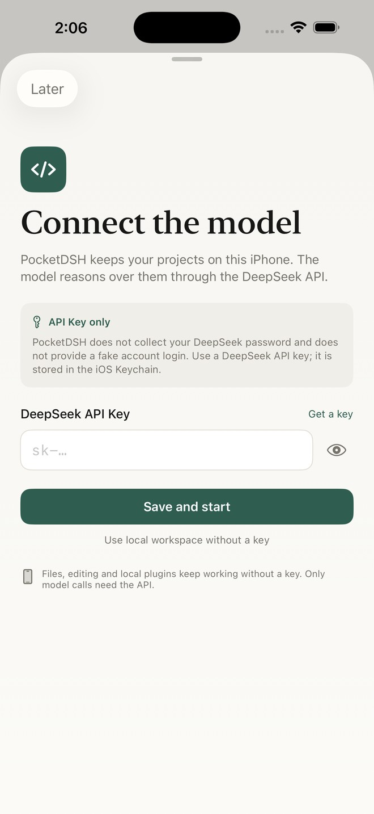
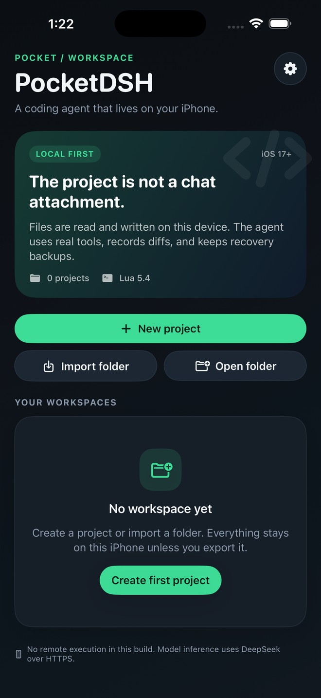
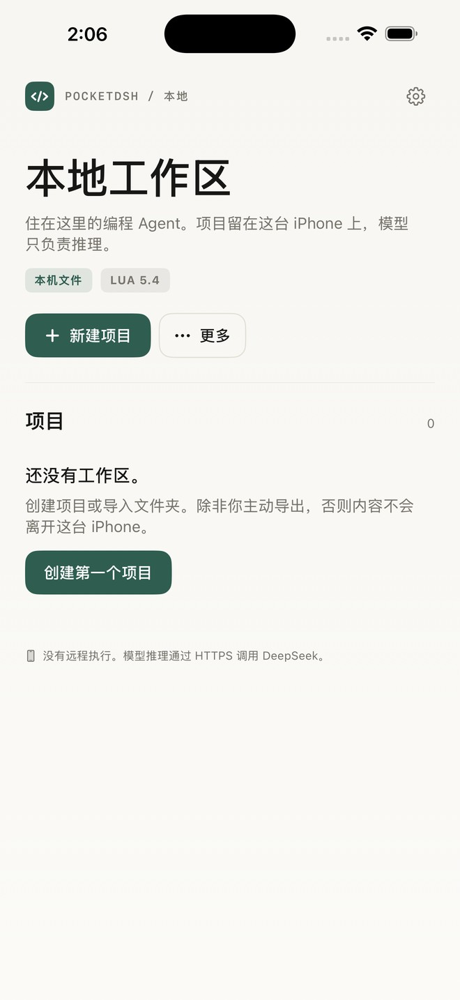
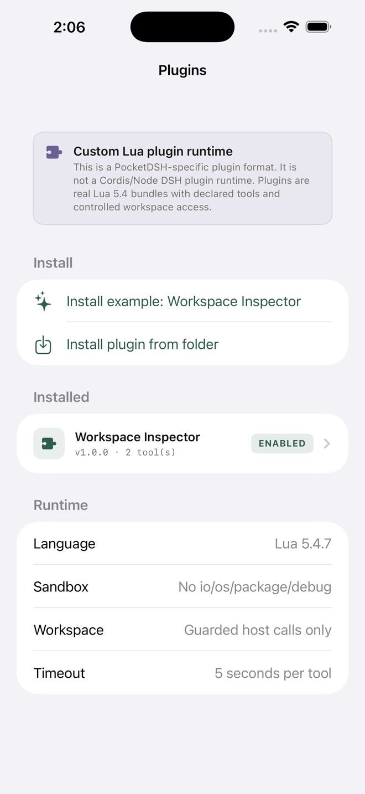
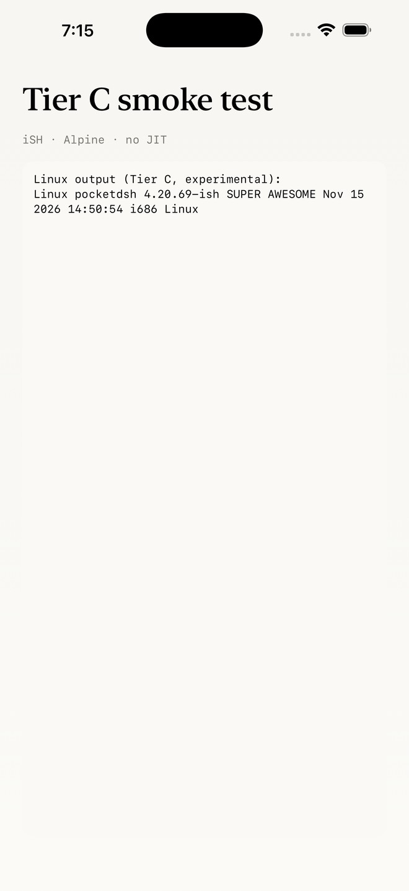

# PocketDSH

以 **iPhone 本身为工作区** 的原生 iOS 编程 Agent App。参考 DSH 的任务/工具循环，但文件和执行都留在手机上。

- 原生 SwiftUI，iOS 17+
- 多项目本地工作区 + 文件树 / 编辑器 / 搜索 / diff
- **17 个 Agent 工具**：
  - 文件与执行：`list_files`、`read_file`、`write_file`、`search_files`、`apply_patch`、`run_lua`、`run_linux`
  - 网络：`fetch_url`、`web_search`
  - 系统能力：`schedule_reminder`、`schedule_alert`、`prepare_message`、`prepare_call`
  - 流程：`todo_write`、`present`、`subagent`、`use_skill`
- 嵌入 Lua 5.4.7，无 JIT、无 shell、无子进程
- DeepSeek API 推理，API Key 存 iOS Keychain
- 覆盖前备份、恢复历史、任务日志、取消、对话持久化
- 可安装的本地 Lua 插件：安装、加载、配置、启停、卸载，工具自动接入 Agent
- 极简浅色 / 深色界面，支持跟随系统 / 简体中文 / English
- Agent 可选 `deepseek-flash` / `deepseek-v4-pro`，可调推理强度（low/high/max）和思考模式
- Linux VPS 只开发/检查/编译，不执行用户任务

## 当前状态（2026-11-17）

| 阶段 | 状态 | 证据 |
| --- | --- | --- |
| 源码与工作区 UI | 已完成 | SwiftUI 多项目 / 文件树 / 编辑器 / 搜索 / diff |
| 核心与 Lua 测试 | 通过 | 16 个 SwiftPM 测试 |
| iOS 编译 | **通过** | run [#43763977454](https://github.com/zqlnys/PocketDSH/actions/runs/43763977454)，Xcode 26.3（公开仓库免费 macOS runner） |
| iOS 模拟器测试 | **通过** | 8/8，含插件完整生命周期测试 |
| 未签名 arm64 IPA | **已生成** | 5,295,073 bytes，SHA-256 `237d0175…0780` |
| 插件系统 | **已实现并测试** | 安装 / 加载 / 配置 / 启停 / 卸载 / 工具接入 |
| **E2 aarch64 后端** | **可运行静态 busybox；grep / sed / awk 与参考实现逐字节一致** | 246 项单指令测试、163 条 M2、93 条 M3、288 条差分用例，详见 [docs/E2-BACKEND.md](docs/E2-BACKEND.md) |
| E2 未完成项 | **CPython 启动阶段仍有差异** | 解释器能跑，`getpath` 阶段行为不同；`pow` 运算符结果错误 |
| 系统动作 | **部分实现，未真机验证** | 真实提醒 + 电话/消息准备，必须用户确认 |
| 构建目标 | **发布版无 GPL 代码** | `PocketDSH` 不含 iSH，可上架；`PocketDSH-Lab` 含完整 Tier C |
| 首次启动引导 | **已实现** | API Key 弹窗，可跳过并继续本地工作区 |
| 模型 / 推理强度 | **已实现** | 当前 DeepSeek V4 模型名 + low/high/max，思考模式默认关闭 |
| 纯 Linux iOS 构建 | **受阻** | 需要 Apple Xcode.xip + xtool Darwin SDK；本机没有该文件 |
| IPA 已签名 | 未执行 | 由用户的签名证书完成 |
| 真机安装 | 未执行 | 需要实体 iPhone 和签名 |

> 当前 IPA 来自 GitHub Actions macOS Runner，不是纯 Linux 构建。没有把“Linux 源码检查”冒充成“iOS 编译”。详见 [阶段验证](docs/PHASE1-VALIDATION.md) 和 [构建记录](docs/BUILD.md)。

## 界面预览（CI 模拟器实拍）

| 首次启动 | 首页 Light | 首页 Dark | 简体中文 |
| --- | --- | --- | --- |
|  |  |  |  |

插件管理：



语言可在 Settings → Language 中切换。JIT 状态在 Settings → JIT & Runtime 中查看。

工作区采用桌面式左侧栏：


主 App 内的 Tier C smoke test：



截图由 CI 在 iPhone 17 Pro Max 模拟器中实际安装并启动 App 后抓取；不代表实体 iPhone 测试。

## 快速开始（Linux）

```bash
cd /root/dsh/PocketDSH
make check
```

已验证的本地能力：

- `PocketDSHCore` 8 个测试
- `LuaRuntime` 8 个测试（含 3 个持久插件运行时测试）
- `PocketDSHTests` **26 个测试**（应用层，Xcode 中运行）
- `swiftc -parse` 全部 Swift 源文件
- XcodeGen spec 解析和工程生成（Linux 上使用 XcodeGen 二进制）
- 无 Token / 私钥 / WebView / Flutter 依赖

> Linux 只能做语法级 Swift 检查和 SwiftPM 测试，不能编译 SwiftUI/iOS。

## 验证全部内容

```bash
./tools/verify.sh
```

一条命令跑完两部分：

| 部分 | 内容 |
| --- | --- |
| E2 后端 | 246 项单指令测试、163 条 M2、93 条 M3、288 条差分用例，静态与动态 busybox 各跑一遍 |
| iOS 源码 | 6 类静态检查（工具名、工具处理、规格一致、测试标签、测试类归属、括号平衡）|

任一部分不干净就返回非零。

**这里的每个数字都来自命令输出，没有豁免、没有 `|| true`、没有「已知失败」抵扣。**

E2 后端另需两个工具：`clang` 与 `ld.lld`（交叉编译测试用的 aarch64 guest 程序），
以及静态 busybox 与 Alpine 根文件系统（放在 `/tmp/alpine-root`）供扫描与差分测试使用。

**验证刚克隆的仓库是否完整**：

```bash
./tools/fresh-clone-check.sh
```

它会克隆到 `/tmp`、构建、跑完整验证。**这是「在我这儿能用」和「别人拿到能用」的分界线**——
因为开发用的工作目录会积累测试留下的文件和手工建的设备节点，克隆一份新的才没有那些。

## 目录

```text
PocketDSH/
├── project.yml                  # XcodeGen 单一工程源
├── Packages/PocketDSHKit/
│   ├── Sources/PocketDSHCore/   # 路径守卫、文件系统、patch、diff、模型
│   ├── Sources/CLua/            # vendored Lua 5.4.7 + C bridge
│   ├── Sources/LuaRuntime/      # Swift async runtime
│   └── Tests/
├── PocketDSH/
│   ├── App/                     # AppState, root, navigation
│   ├── Core/Services/           # Keychain, DeepSeek, project store, agent loop
│   ├── Core/Design/             # theme / cards
│   └── Features/                # Projects, Files, Editor, Agent, Changes, Plugins, Settings
├── PocketDSHTests/
├── examples/workspace-inspector.dshplugin/
├── scripts/
├── docs/
└── .github/workflows/ios.yml
```

## 构建路径

### 方案 A：纯 Linux（需要 Xcode.xip）

[xtool](https://github.com/xtool-org/xtool) 可以在 Linux 上交叉编译 SwiftUI iOS App，但它需要：

1. Swift 6.4 工具链（已装 6.4.2）；
2. 从 Apple 官方下载的 `Xcode.xip`；
3. `xtool setup` 登录 Apple 账号并构建 Darwin Swift SDK；
4. 可选 `usbmuxd` 用于真机安装。

这台 VPS 目前是：

```text
xtool 1.24.0          installed
xtool auth status     Logged out
xtool sdk status      Not installed
Xcode.xip             absent
```

因此 **纯 Linux IPA 尚未生成**。不会从非官方镜像下载 Apple SDK，也不会伪造构建产物。

### 方案 B：GitHub Actions macOS（当前用于编译验证）

仓库提供 `.github/workflows/ios.yml`：

- 选择最新稳定 Xcode
- XcodeGen 生成工程
- `swift test` 跑领域和 Lua 测试
- 编译 iOS 真机架构 Debug/Release
- 模拟器测试
- 启动 App 并抓取浅色/深色截图
- 生成未签名 `PocketDSH-unsigned.ipa`
- 上传日志、截图、IPA
- 最终 gate 不允许跳过测试

这是云端 macOS，不是 Linux 原生编译。是否使用它作为首个 IPA 构建路径，需要明确记录；不会把它称为“纯 Linux 构建”。

## 本地运行逻辑

```text
ProjectStore -> WorkspaceSession
  -> WorkspaceFileSystem (root + path guard + backups)
  -> ToolExecutor (real files, real Lua)
  -> AgentRunner (DeepSeek tool loop)
```

Agent 只会拿到相对路径。绝对路径、`..`、symlink 逃逸都会被 `WorkspacePathGuard` 拒绝。

## 安全与限制

- API Key：iOS Keychain，`AfterFirstUnlockThisDeviceOnly`；不写项目文件。
- 文件：仅在当前项目 root 或用户授权的 security-scoped 目录内。
- 网络：只访问 `https://api.deepseek.com`；本地文件/编辑器不依赖网络。
- 运行时：Lua 5.4，无 `io`/`os`/`package`/`debug`/`dofile`/`loadfile`，无 JIT、无 shell、无 `fork/exec`。
- 插件：**PocketDSH 自定义 Lua 插件格式**，不是上游 DSH Cordis 插件，也不是 dsh-Go 原生插槽协议。
- 未实现：Linux 用户态 ABI、完整系统仿真、Cordis/Node 原生插件、SSH/SFTP。
- 未验证：真机安装、IPA 签名、TestFlight。
- 纯 Linux 构建未完成；当前 IPA 来自 GitHub macOS Runner。
- **两个构建目标**：`PocketDSH` 是发布版，不编译也不链接任何 iSH 代码，二进制里没有 GPL 组件，可以上架；`PocketDSH-Lab` 是开发版，含完整 Tier C（iSH Alpine 持久 shell、`/workspace` realfs 挂载、只读挂载），是 GPLv3 衍生作品，不发布。详见 [构建目标与许可边界](docs/BUILD-TARGETS.md)。
- Tier C（仅 Lab 版）：`run_linux` 在一个持久 iSH Alpine shell 里执行，每条命令约 0.4s；项目目录通过 realfs 直通挂载在 `/workspace`。

## 文档

- [架构与兼容性判断](docs/ARCHITECTURE.md)
- [阶段 1 验证记录](docs/PHASE1-VALIDATION.md)
- [最新构建与 IPA 证据](docs/BUILD.md)
- [DSH / dsh-Go 兼容范围](docs/DSH-COMPATIBILITY.md)
- [PocketDSH 插件 SDK](docs/PLUGIN-SDK.md)
- [闹钟 / 电话 / 消息的系统能力边界](docs/SYSTEM-ACTIONS.md)
- [执行探测：iOS 能不能跑运行时加载的代码](docs/EXECUTION-PROBE.md) —— **E2 为什么必须存在**
- [Tier C 本地 Linux 可行性](docs/TIER-C.md)
- [Tier C 项目工作区挂载](docs/WORKSPACE-MOUNT.md)
- [Tier C 持久 shell](docs/PERSISTENT-SHELL.md)
- [构建目标与许可边界](docs/BUILD-TARGETS.md)
- [iOS 本地 Linux 三方案调研](docs/IOS-LOCAL-LINUX.md)
- [构建与安装](docs/BUILD-INSTALL.md)

**E2 后端**（自写的 aarch64 解释器，不复用 iSH）：

- [E2 后端：设计、进度与踩坑记录](docs/E2-BACKEND.md) —— 790 项验证背后的每一次修复
- [交接文档](docs/HANDOFF.md) —— 换新会话时先读这个

**调试工具**（都在 `e2/tools/`）：

| 工具 | 用途 |
| --- | --- |
| `e2run.sh` | 跑 harness，状态行不会因为管道过滤而丢失 |
| `mutation-check.sh` | 验证一条测试是否真能抓到回归 |
| `diff-test.sh` | 与参考实现逐字节对比；写临时对比脚本时复用它的剥离逻辑 |

## 许可

Lua 5.4.7 以 MIT 许可证 vendored，见 `Packages/PocketDSHKit/Sources/CLua/LICENSE`。
