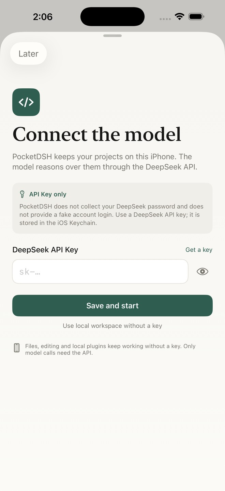
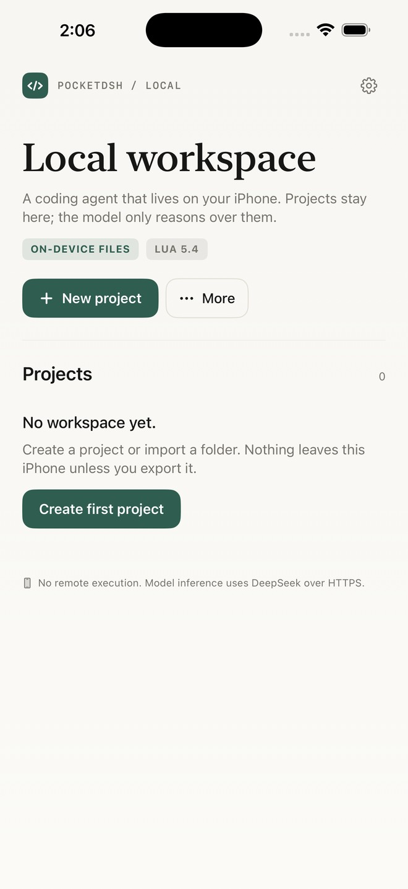
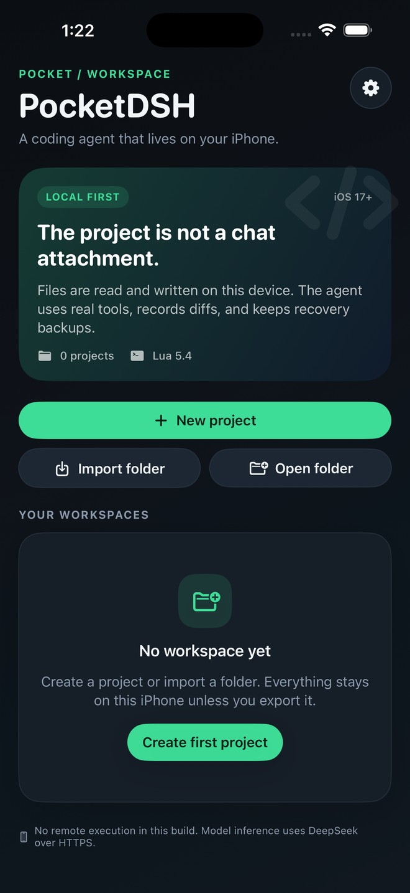
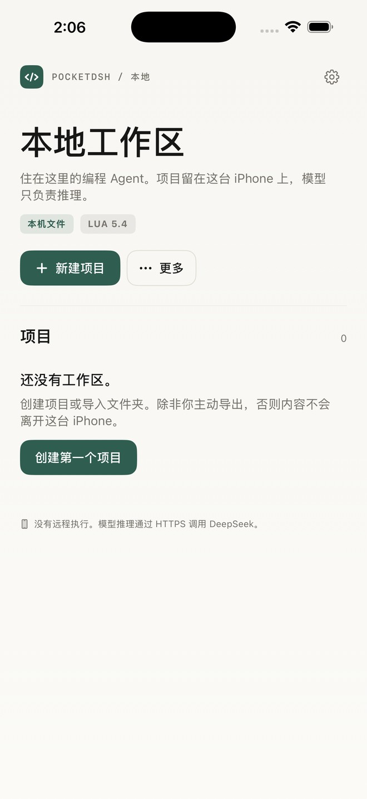
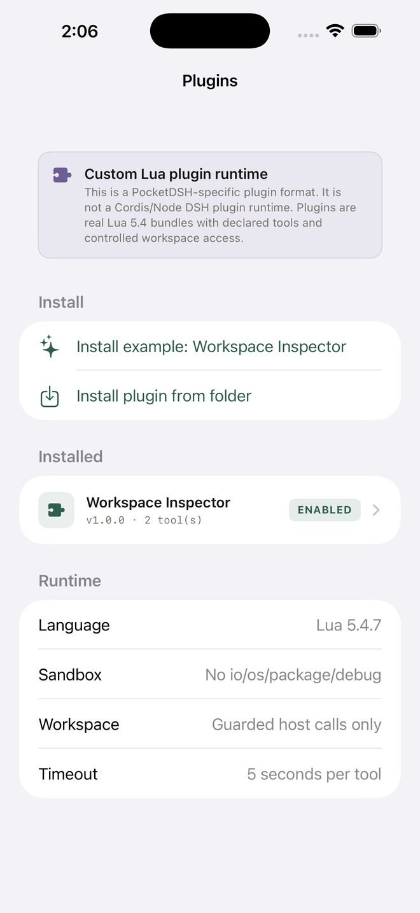

# 构建记录

## 最新绿色构建

| 项目 | 值 |
| --- | --- |
| 日期 | 2026-11-15 |
| 仓库 | [zqlnys/PocketDSH](https://github.com/zqlnys/PocketDSH)（private） |
| Workflow | iOS CI |
| Run | [#43730663808](https://github.com/zqlnys/PocketDSH/actions/runs/43730663808) |
| Commit | `32fed39` |
| 结果 | **success** |
| 耗时 | 约 3 分 46 秒 |
| Runner | `macos-15` |
| Xcode | 26.3 (17C529) |
| 模拟器 | iPhone 17 Pro Max, iOS 26.2 (arm64) |
| 构建方式 | GitHub macOS Runner（**不是纯 Linux**） |

### 阶段结果

| 阶段 | 结果 | 证据 |
| --- | --- | --- |
| Xcode 自动选择 | PASS | 26.3 |
| XcodeGen 生成 | PASS | 工程创建成功 |
| PocketDSHCore 测试 | PASS | 8/8 |
| Lua runtime 测试 | PASS | 8/8（5 runtime + 3 plugin runtime） |
| Xcode 真机架构 Debug 编译 | PASS | `** BUILD SUCCEEDED **` |
| iOS 模拟器测试 | PASS | 6/6，`** TEST SUCCEEDED **` |
| 插件生命周期测试 | PASS | install → enable → invoke → configure → disable → uninstall |
| 模拟器启动 | PASS | API 引导 / 首页浅色 / 深色 / 简体中文 / 插件页截图 |
| Release 真机架构编译 | PASS | `** BUILD SUCCEEDED **` |
| 未签名 IPA | PASS | `PocketDSH-unsigned.ipa` |

### Tier C 可行性（独立 spike）

iSH 的无 JIT Linux 路径已做两项验证：

- Linux 主机：iSH CLI + Alpine 3.20.3，实际输出 `Linux ... i686` 和 `3.20.3`；
- iOS：在 macOS runner 构建出 arm64 `libish.a`、`libish_emu.a`、`libfakefs.a`，run `43726162035`；
- iOS 模拟器：独立 `TierCProbe` target 实际执行 Alpine `/bin/sh`，输出 `Linux pocketdsh ... i686 Linux`，run `43730347674`，无 JIT。

这还不是主 App 内的 Tier C 后端；probe 生命周期和主 App 集成仍未完成，详见 [TIER-C.md](TIER-C.md)。

### 系统动作

新增：

- `schedule_reminder`：通过 EventKit 创建真实提醒（不是系统时钟闹钟）；
- `prepare_message`：准备系统消息编辑器，用户必须点击发送；
- `prepare_call`：准备拨号确认，用户必须确认。

受 iOS 沙盒限制，不读取/自动回复 Messages，不静默拨号，不使用描述文件或漏洞。当前只完成编译和模拟器构建验证，没有真实设备权限测试。

### 模型与推理

- 模型名更新为当前 API 文档中的 `deepseek-flash` / `deepseek-v4-pro`；
- Agent 顶部和 Settings 都可选择模型；
- 推理强度支持 `low` / `high` / `max`；
- 思考模式默认关闭，避免工具调用链路的额外延迟；
- 请求会发送 `thinking` 和 `reasoning_effort` 字段。

### JIT 与运行时

- `JITCapability` 在真机上用 mmap 探测可执行内存映射，不执行任何动态代码；
- 模拟器直接报告无 JIT，避免把 Runner 能力误报成设备能力；
- 没有 JIT 时自动使用 Tier A；
- 运行时偏好可选 Automatic / Tier A / Tier C；选择 Tier C 会显示受限提示，但 **Tier C 后端尚未集成**，仍回退 Tier A；
- 开关只保存偏好，不能授予 JIT entitlement。

### 插件验证

iOS 测试 `PluginLifecycleTests.testInstallEnableInvokeConfigureDisableUninstall` 实际执行：

1. 把内置示例插件写入 App 的插件目录；
2. 创建持久 Lua 运行时并加载 `main.lua`；
3. 把插件工具 `write_pocket_note` 以 `plugin__...` 名称接入工具表；
4. 通过 Agent 使用的 `ToolExecutor` 调用插件工具；
5. 经受控 host API 写入真实工作区文件 `PLUGIN_TEST.md`；
6. 校验文件内容与插件日志；
7. 修改配置并重载，再次通过 `ToolExecutor` 写入，验证 prefix 已生效；
8. 禁用插件，确认工具表为空；
9. 卸载，确认插件目录删除，工作区文件保留。

测试 workspace 是 iOS 模拟器中的临时真实目录，不是 mock 文件系统。

### IPA

| 项目 | 值 |
| --- | --- |
| Artifact | `pocketdsh-ios-38/PocketDSH-unsigned.ipa` |
| Bundle ID | `com.example.pocketdsh` |
| Version | 0.1.0 (1) |
| MinimumOSVersion | 17.0 |
| UIDeviceFamily | `[1]`（iPhone） |
| 架构 | `arm64` Mach-O |
| 签名 | **未签名**；无 `_CodeSignature` / `mobileprovision` |
| 大小 | 1,513,378 bytes |
| SHA-256 | `14ba61f03bf645cfae6e64336684762fd243d8c80f610daf48268960f7d4bcaa` |

下载：

```bash
gh run download 43730663808 -n pocketdsh-ios-38 -D ./download
gh run download 43730663808 -n pocketdsh-test-results-38 -D ./test-results
```

### Warnings

6 条 warning 均为工具层提示，不是 Swift 编译 warning：

- `appintentsmetadataprocessor`: 没有 AppIntents 依赖，跳过元数据提取（5 次构建各一条）。
- `xcodebuild`: 同一模拟器有 arm64/x86_64 两个 destination，使用第一个匹配项。

没有编译错误、测试失败或伪造结果。

### 截图

| 首次启动 | 首页 Light | 首页 Dark | 简体中文 |
| --- | --- | --- | --- |
|  |  |  |  |

插件管理：



## 修复记录

| 轮次 | 失败 | 修复 |
| --- | --- | --- |
| 1 | `withSecurityScope` 在 iOS 不可用 | 改为 iOS 的 `.minimalBookmark` / `.withoutUI` |
| 2 | 插件工具名测试在非隔离上下文调用 `@MainActor` | 测试标注 `@MainActor` |
| 3 | 一个未使用的 `try?` warning | 改为 `_ = try?` |
| 4 | 插件行重复 chevron | 行内改为状态 pill，详情页统一导航 |

## 纯 Linux 构建

仍未完成：

```text
xtool 1.24.0          installed
xtool auth status     Logged out
xtool sdk status      Not installed
Xcode.xip             absent
swiftc -target arm64-apple-ios17.0
  -> unable to load standard library
```

xtool 需要合法 Apple Xcode.xip 生成 Darwin Swift SDK。没有该文件时不能把当前 macOS CI 产物描述成“Linux 原生编译”。

## 尚未验证

| 阶段 | 状态 |
| --- | --- |
| IPA 已签名 | 未执行 |
| 真机安装 | 未执行 |
| 真实设备运行 | 未执行 |
| TestFlight | 未配置 |
| 纯 Linux iOS 构建 | 未完成（需要 Xcode.xip） |
| 完整 DSH/Node 插件兼容 | 未实现（自定义 Lua 插件已实现） |
