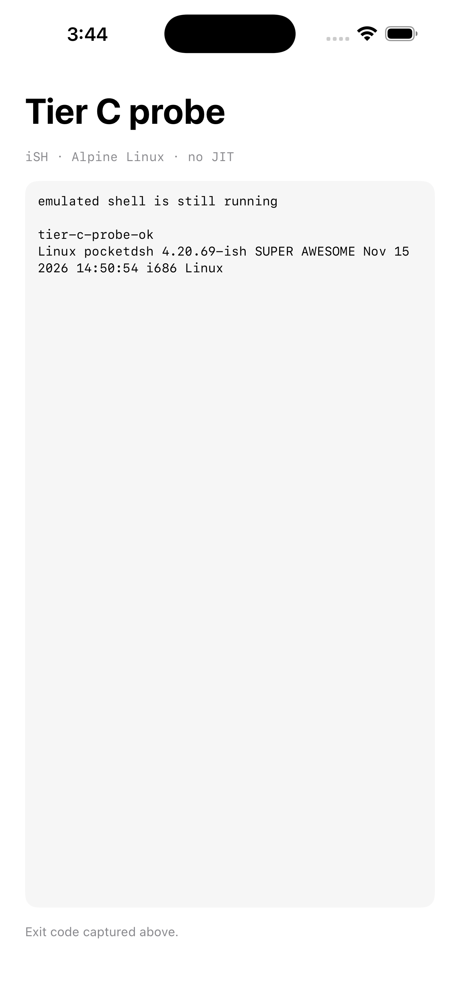

# Tier C：iPhone 本地 Linux 可行性

状态：**主 App 已链接 iSH，并跑通 Tier C smoke test；仍是实验性单命令后端。**

主 App 默认运行时仍是 Tier A。Tier C 通过 `run_linux` 工具显式调用，不是全局自动路由。

## 结论

iOS 不允许普通 App 创建进程或使用 JIT，但 **iSH** 提供了一条合法的无 JIT 路径：

- x86 用户态指令解释器；
- Linux syscall 翻译；
- 不需要 JIT；
- 不需要 fork/exec 宿主进程；
- 可以在 iOS App 进程内运行 Alpine Linux 用户态。

这不是“完整 Linux 虚拟机”，但足以提供 Linux shell、文件系统和大量命令行工具。

## 原始证据

- [iSH Alpine 运行输出](tierc/ish-uname.txt)
- [iOS 静态库构建记录](tierc/ios-static-libs.txt)

## 主 App 内已跑通

Build 32 的 `PocketDSH` 主 App 内置 iSH 静态库和 Alpine rootfs，运行：

```text
uname -a
```

返回：

```text
Linux pocketdsh 4.20.69-ish SUPER AWESOME ... i686 Linux
```

截图：[tierc.jpg](screenshots/tierc.jpg)

限制：

- 一次 App 启动只支持一个 `run_linux` 命令；
- 还不能访问 iPhone 项目工作区；fakefs 元数据不会自动收录裸拷贝文件；
- 没有持久 shell；
- 不是默认 Tier A 的替代品。

## 已验证

### 1. 无 JIT Linux 可运行

在 Linux 主机上构建 iSH CLI，加载 Alpine 3.20.3 x86 minirootfs，实际执行：

```text
$ ./ish -f alpine /bin/sh -c 'echo hello-from-ish; uname -a; cat /etc/alpine-release'
hello-from-ish
Linux racknerd-9ef0a31 4.20.69-ish SUPER AWESOME ... i686 Linux
3.20.3
```

说明 iSH 的 syscall 翻译和 fakefs 能运行真实 Alpine 用户态。

### 2. iOS arm64 静态库可构建

GitHub Actions macOS runner 使用 Xcode 26.3 构建 iSH：

- Run：<https://github.com/zqlnys/PocketDSH/actions/runs/43726162035>
- 产物：
  - `libish.a` ~1.9 MB
  - `libish_emu.a` ~1.5 MB
  - `libfakefs.a` ~65 KB
- 目标：`iphoneos/arm64`
- 使用 Homebrew LLVM/LLD 编译 i386 VDSO。

这证明 **Tier C 的核心静态库可以在 iOS 工具链下生成**。

### 3. iOS Simulator CLI 链接通过

使用 device/simulator 两套静态库链接了一个 arm64 iOS Simulator CLI，链接成功。

但直接 `simctl spawn` 运行 CLI 触发 `Trace/BPT trap`。这不是库链接失败，而是裸 CLI 缺少 App/UIApplication 生命周期与沙盒上下文。Tier C 必须作为 App 内后端运行，不能用 CLI 方式验证。

证据：[ios-link-smoke.txt](tierc/ios-link-smoke.txt)

### 4. iOS 模拟器内实际运行 Alpine

`TierCProbe` 使用 iSH 静态库和 Alpine fakefs rootfs，在 iOS 26.2 模拟器内实际执行：

```text
tier-c-probe-ok
Linux pocketdsh 4.20.69-ish SUPER AWESOME ... i686 Linux
```

- **没有 JIT**；
- 运行在 App 进程内；
- 不是远程主机；
- 证据：[ios-runtime-success.txt](tierc/ios-runtime-success.txt)



已知问题：emulated shell 在命令输出后仍保持运行，probe 使用 3 秒观察窗口读取输出。接入主 App 前需要实现持久 shell 的命令/退出协议，不能把 probe 的固定等待窗口当成正式工具。主 App 目前仍未链接 iSH，Tier C 仍不可用。

持久 shell 原型（run `43731872117`）未稳定启动，已回退到已验证的一次性 probe；shell 生命周期仍是下一个阻塞点。

## 尚未完成

- 把 iSH 静态库链接进 PocketDSH App；
- 打包 Alpine fakefs rootfs；
- 写 C/Swift 桥接，调用 `xX_main_Xx` + `task_run_current`；
- 捕获 stdout/stderr、超时、停止、后台限制；
- 申请 App 体积/内存预算；
- 与 Agent 工具循环对接；
- 真机验证。

## 集成方案

1. 固定 iSH commit（已验证 `ce96e698f1820b9d8db47e87c501ecb89119d7ce`）。
2. 在 CI 构建 `libish.a`、`libish_emu.a`、`libfakefs.a` 和头文件。
3. 将 Alpine fakefs rootfs 作为资源打包，首次启动复制到 Application Support。
4. 增加 C bridge：
   - `pocket_ish_run(root, argv, timeout)`
   - 重定向 stdin/stdout/stderr；
   - 设置 `exit_hook`，避免顶层 `exit()` 终止 App；
   - 在专用串行队列运行，不阻塞 UI。
5. Swift 侧 `LinuxRuntime` actor 串行化命令，暴露 `run_command` 工具。
6. Tier C 选择只有在 bridge 成功初始化后才启用；否则明确回退 Tier A。

## 限制

- 无 JIT，性能明显低于原生；
- 不是完整内核/虚拟机，不能假设 Docker/KVM；
- 后台执行受 iOS 限制；
- 初始 rootfs 和二进制会显著增加 IPA；
- 需要真机内存/稳定性测试。

在这些完成前，PocketDSH 不会把 Tier C 标记为可用。

## 与 JIT 的关系

iSH 不需要 JIT。即使没有 JIT，也可以走 Tier C 的解释执行路线。

如果未来获得了合法 JIT entitlement，可以再评估更快的后端（例如 QEMU/TCG 或 Node/V8），但那是另一条优化路线，不是当前 iSH 集成的前提。
